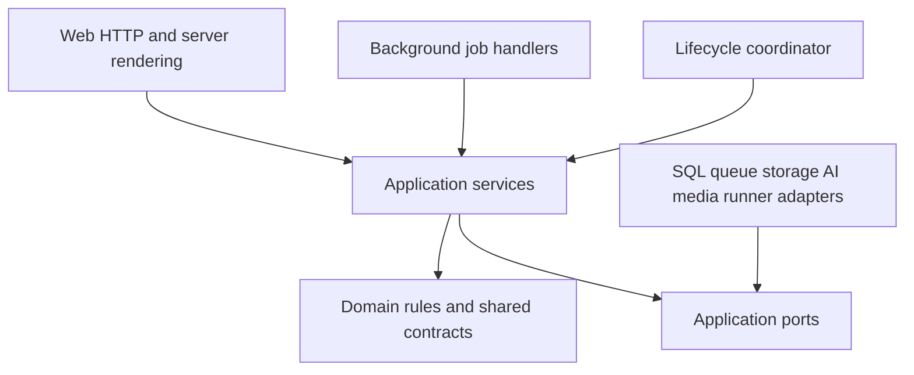
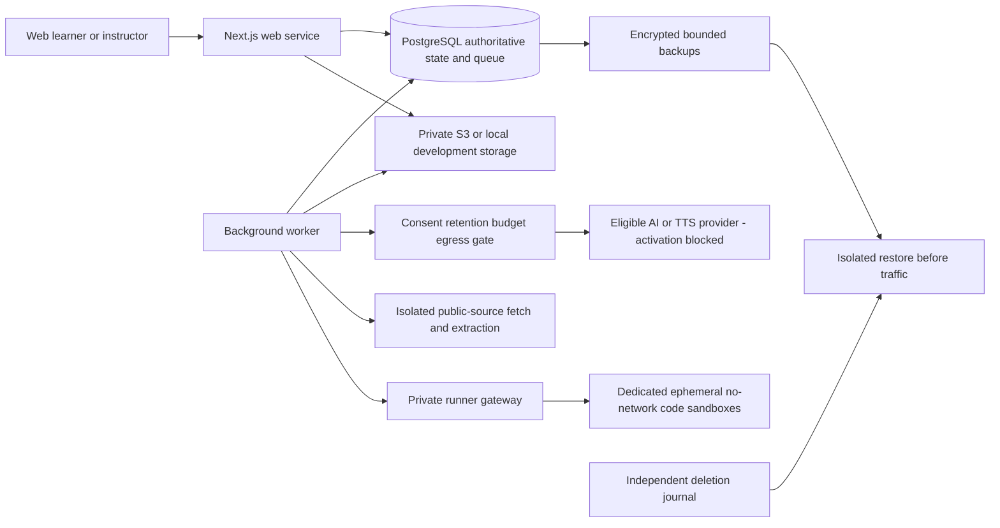
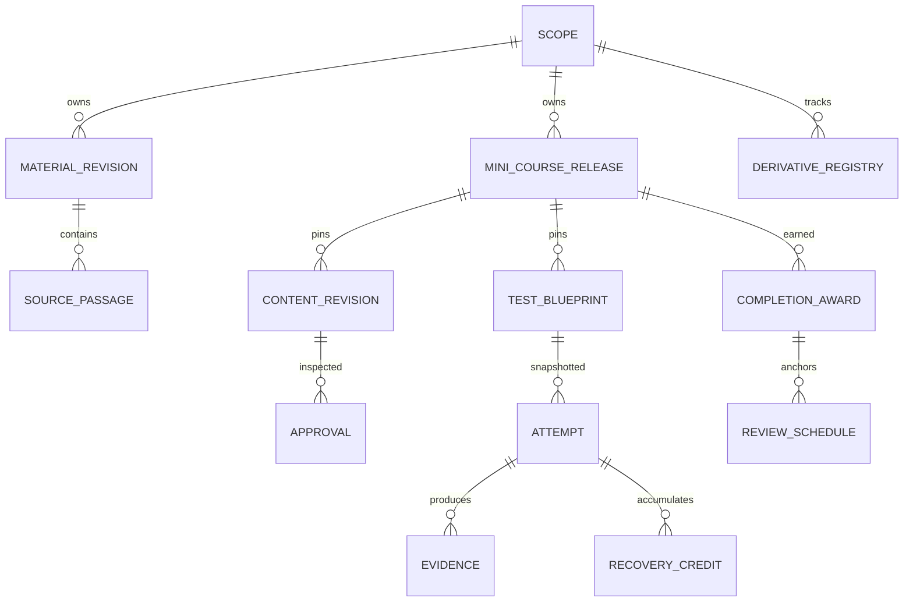

# Architecture Spine — AI Learning Platform

## Design Paradigm

**Modular monolith with ports and adapters:** one TypeScript codebase, a Next.js web process and a separate background worker, with PostgreSQL as the authoritative state store. Domain/application modules own behavior; HTTP, database, queue, storage, AI and execution adapters implement their ports. No separate public backend, microservices, Redis, vector database or event-sourced system in the initial seed.

`[ADOPTED]` identifies inherited product requirements. `[ASSUMPTION]` identifies an assistant-selected technical choice under the delegated Fast path: binding for downstream planning until explicitly revised, not implemented or individually user-selected. Final architecture status means the planning contract passed review, not that release gates passed. Rationale is in the run log; [source checks and feasibility gates](source-checks.md) distinguish evidence from targets.

## Invariants & Rules

### AD-1 — Module boundaries and dependency direction [ASSUMPTION]

- **Binds:** all epics.
- **Prevents:** HTTP, workers and activity integrations implementing incompatible business rules or directly writing each other's tables.
- **Rule:** both processes call the same application services. Only a module's repository writes its tables. Cross-module commands use exported application interfaces; read projections use explicit scoped query interfaces, never arbitrary cross-module SQL in handlers. Pure domain logic depends on contracts, not Next.js, SQL or provider SDKs. CI checks import direction. Lifecycle is the explicit cross-module orchestration exception, calling registered deletion/export ports rather than writing foreign tables.



| Module               | Single write authority                                                                  |
| -------------------- | --------------------------------------------------------------------------------------- |
| Identity/access      | Accounts, sessions, capabilities, enrollment and authorization epochs                   |
| Materials/setup      | Scoped uploads, extraction revisions, goals, plan and setup diagnostic                  |
| Learning/content     | Source claims, objectives, content/activity revisions, conversations, generation        |
| Publication          | Draft dependencies, inspected approvals, release manifests, withdrawals                 |
| Assessment/progress  | Attempts, grades, recovery ledgers, evidence and completion awards                      |
| Review               | Review schedules, preferences, in-app reminders                                         |
| Instructor/reporting | Course metadata, roster-import orchestration; read-only scoped reporting projections    |
| Lifecycle/platform   | Scope tombstones, derivative registry, exports/purge orchestration; jobs and operations |

Epic ownership is delivery accountability, not a permission to duplicate a module. Epic 1 supplies the first setup-inference/diagnostic adapter, versioned processor configuration/eligibility evidence and reusable consent/dispatch/accounting/lifecycle ports; epic 2 extends them for full generation/retrieval and re-gates changed model/endpoint/features/purpose/location/retention. No blanket eligibility or consent is inherited. Epic 5 integrates publication/enrollment without redefining assessment or review.

### AD-2 — Atomic commands and authoritative state [ASSUMPTION]

- **Binds:** all mutations and jobs.
- **Prevents:** committed progress without evidence, orphan jobs, duplicate submission credit and web/worker races.
- **Rule:** one checked-out `pg` client transaction commits a command's authorization check, expected-revision check, state changes, idempotency receipt and necessary queue enqueue through a `Db.executeSql` adapter. Never mix `pool.query` calls into that transaction. Unique constraints arbitrate duplicate commands/effects; row locks serialize attempt finalization, recovery credit, completion, enrollment and lifecycle transitions. Authorization changes and protected mutations serialize on the relevant scope/enrollment fence; a read followed by an unlocked write is insufficient. No provider call or long extraction inside a SQL transaction. PostgreSQL owns truth; caches/projections may be rebuilt and never award progress.

### AD-3 — Identity is not resource authorization [ADOPTED: D5; ASSUMPTION: mechanism]

- **Binds:** R2, R4, R5, R16, R22; web, worker and media reads.
- **Prevents:** cookie-only checks, self-promotion, revoked enrollment retaining access and cross-owner retrieval.
- **Rule:** use Better Auth database-backed opaque cookie sessions with cookie cache disabled and `deferSessionRefresh: true`; validate current session on the server, not merely cookie presence. GET stays read-only; client/server-rendered journeys handle required refresh via POST. Every application operation resolves actor and resource scope server-side: `personal(ownerUserId)` or `course(courseId)`. Instructor capability is admin-assigned; course ownership and verified active enrollment are checked separately. Admin UI sees metadata, not personal content. Private responses are dynamic, `no-store`, not CDN/shared cached; repository/retrieval queries require scope and resource-subject/action predicates. Downloads are streamed through the authorization boundary, not reusable presigned GET URLs. Revocation increments an authorization epoch and stops future reads/jobs/reminders immediately; already-delivered bytes cannot be recalled. Abort controlled streams on revocation; do not promise remote client erasure.
- **Rule:** active enrolled learners can read approved published course content and create/read only their own attempts, evidence, conversations and review state. Same-course enrollment never grants peer-resource or roster access. Course owners manage their drafts/roster and permitted grading/reporting; learner private conversations are not part of participation reports. After removal, an authenticated verified former learner may export only their own retained progress/scores through a distinct self-history action, without current enrollment, question/answer bank, other learners or new course activity. Course-controlled record retention remains D5; no generic course-scope predicate substitutes for these actions.

### AD-4 — Ownership, lineage and deletion fences [ADOPTED: D5; ASSUMPTION: mechanism]

- **Binds:** R1–R5, R16, R22; every persistent derivative and external adapter.
- **Prevents:** orphan embeddings/media/queue payloads, deletion races, account deletion silently destroying another controller's course records and restored deleted data resurfacing.
- **Rule:** assign immutable scope at creation; personal uploads never become shared course sources by changing an ID. Every derivative registers scope, source lineage, storage locations, external request reference and retention class. Personal material deletion includes its generated courses, conversations, evidence and review state. Course source/content and course attempts are course-controlled records; learner export contains only their own scores/progress, no restricted bank or roster. Account/personal deletion does not silently delete legitimate course records; legal/institutional incompatibility blocks real use until an explicit policy decision.
- **Rule:** authorization scope is not a deletion target. A material-root deletion fences that root and all transitive dependent artifacts, including multi-parent outputs, while preserving unrelated roots in the same personal scope. Whole-personal/account deletion explicitly selects all personal roots, not instructor-controlled records. The deletion transaction tombstones targets, advances lineage-fence generations and cancels affected use/reminders before returning. Jobs snapshot and check all relevant ancestor fences plus the authorization epoch at admission, immediately before egress and before committing results. An egress fence serializes dispatch against revocation; already-dispatched work is tracked, canceled where supported, discarded on return and included in provider purge obligations. Late outputs cannot repopulate deleted targets. Module lifecycle ports enumerate originals, indexes, versions, media, job results, exports and external copies; active purge deadline is seven days. Export artifacts use the same authorization/deletion path and expire within 24 hours. Course archive schedules notice/export and purge at 90 days. Content-free operational metadata expires within 30 days.
- **Rule:** backups expire within 30 days. A separately retained, content-free protective-state journal covers the maximum backup/restore horizon, expires after that horizon and is replayed before restored traffic/jobs. It records deletion fences and protective revocations/withdrawals under AD-17, never raw content. Its delivery/completeness is part of the safety contract: an incomplete journal means fail-closed restore, not stale grants. It is included in the same retention inventory; no indefinite audit trail is implied. Restores and provider exceptions must be proven compatible before real data.

### AD-5 — Immutable publication and dependency identity [ADOPTED: D1/D3/D4; ASSUMPTION: mechanism]

- **Binds:** R3, R5, R6, R8, R11, R13, R14, R20.
- **Prevents:** stale approval, silent course upgrades and a citation/rubric edit changing past attempts.
- **Rule:** sources/passages, objective groups, lessons, activities, questions, answer/rubric/feedback bundles and policies have immutable revision IDs and content hashes. A published mini-course release manifest pins every required item, test blueprint, objective mapping and approval dependency. Draft edits create new revisions; dependency changes invalidate affected draft approvals. Publication atomically checks all referenced revisions/approvals. Learner enrollment in a release is pinned until an explicit informed switch; no automatic progress migration or erasure of prior awards. Withdrawals block new uses; already-started attempts affected by invalidity follow AD-8, never a silent replacement.
- **Rule:** a versioned parent path/course requirement manifest pins required versus optional child mini-course releases. Materials/setup or Instructor owns its authoring; Assessment/progress alone evaluates its completion from required child awards. Plan edits or explicit child-release switches create a new parent requirement version; prior version awards remain intact. Roadmaps/reports consume this same progress contract: one node per whole mini-course, separate review/practice indicators and free authorized browsing under D1.

### AD-6 — Exact-version instructor gate includes dynamic output [ADOPTED: D4]

- **Binds:** R3–R6, R8, R11–R14, R17.
- **Prevents:** personalization, role play, why answers or feedback streaming around personal approval.
- **Rule:** in course scope, every learner-visible AI artifact must reference the instructor's inspected approval of its exact revision and dependency set. This includes supplementary sources, narration scripts/audio variants, conversational turns, test/answer/rubric/feedback bundles and fresh retests. Instructor approval is a deliberate authenticated action, not a model/tool decision. Selection/assembly may reuse approved variants; newly generated output remains inaccessible pending approval, with existing approved content or a Pending instructor approval state. No partial streaming of unapproved output. Personal study has an AI/unreviewed label but no instructor gate. Deterministic scoring from an approved rubric is not new AI feedback; a subjective AI grade stays provisional until instructor confirmation.

### AD-7 — Shared evidence without diagnostic dependency cycles [ADOPTED: D2; ASSUMPTION: contract]

- **Binds:** R7–R15, R20, R21; epics 1–4 and 6.
- **Prevents:** a setup diagnostic requiring a finished course, self-report awarding passes and inconsistent activity evidence.
- **Rule:** evidence has immutable ID, actor/scope, objective revision, activity/item revision, timestamp, purpose, assistance flag and provenance. Purpose is one of setup-diagnostic, scored-assessment, practice, review, activity-submission, content-done or self-report. Scores/results are separate typed payloads, not inferred from engagement. Setup owns a 3–5-question skippable diagnostic on the confirmed plan, using shared pure answer/evidence contracts without a published course or assessment attempt dependency. It cannot grant completion/recovery credit. Unknown stays distinct from Needs practice. Guidance cites evidence and uncertainty; learner preferences cannot change instructor-required outcomes.
- **Rule:** full-generation commands must reference an authorized immutable confirmed plan revision and its source revisions. Editing requires new confirmation; jobs cannot replace a queued revision with the latest plan. Stale/canceled references produce an explicit conflict/pending outcome with saved input. A skipped diagnostic neither blocks confirmation nor grants an exemption.

### AD-8 — Scoring, targeted credit and monotonic completion [ADOPTED: D1/D3; ASSUMPTION: arithmetic/ledger]

- **Binds:** R10, R12–R14, R20; all activity and reporting consumers.
- **Prevents:** rounded-score passes, 100%-by-recovery policies, unchecked appeals and progress loss after review or edits.
- **Rule:** snapshot release, questions, test blueprint, rubric, point scale and threshold at attempt start. Use nonnegative scaled-integer points and a rational threshold; compare exact cross-products with overflow-safe integer arithmetic, not floating-point/display rounding. Default is 80%; display one decimal plus authoritative pass status. Instructor overrides and fractional points have declared finite precision; invalid/zero-total rubrics are rejected. Learners cannot post scores/credit. Withhold answers until submission; assisted work is separate from unaided scored attempts. Instructor-course subjective grades remain provisional until confirmed.
- **Rule:** ordinary overall pass satisfies that test even with wrong answers. Only an originally failed test opens recovery: its immutable blueprint maps every item to a stable objective group with declared coverage and cognitive demand; compute initial group results under the same snapshot, preserve passing groups, and ledger all failed groups as targets. Each fresh retest declares target groups and comparable demand/coverage, is checked before use and clears only reassessed groups reaching the root attempt's applicable threshold. No missing/untested target is inferred passed. Root policy remains fixed through that recovery chain; a new policy means a new ordinary attempt, not mixed-policy credit. Original score is never rewritten. Instructor variants require AD-6; personal AI equivalence is labeled and contestable, not psychometric proof.
- **Rule:** completion requires all release-required readings/media explicitly done, required non-test submissions and every required test ordinarily passed or fully recovered. Parent completion requires awards for every required child release in its AD-5 manifest; optional children do not block it. Unique version-scoped awards are monotonic. Invalid items pause only affected pending/unearned decisions; preserve history, annotate defects and offer corrected practice/replacement. No unchecked AI appeal awards a pass. Later review, withdrawal, policy edits and version switching never revoke earned awards; current access may still be revoked. Review outcomes and self-report cannot write completion awards.

### AD-9 — Durable jobs and idempotent effects [ASSUMPTION]

- **Binds:** extraction, generation, publication, purge, grading, review, export and media jobs.
- **Prevents:** exactly-once assumptions, duplicate scores/media/reminders and retries resurrecting deleted data.
- **Rule:** use pg-boss over PostgreSQL; enqueue atomically with AD-2. Assume at-least-once execution. Queue payloads contain scoped IDs, generation, contract version and operation key, not document/answer bodies. Application job state is queued/running/succeeded/retryable-failed/permanent-failed/canceled, with lease/heartbeat and durable progress. Unique effect keys guard commits; retries reuse operation IDs, bounded exponential backoff and dead-letter disposition. External calls have persisted dispatch receipts and bounded retries; unknown outcomes are reconciled, never blindly repeated as free/idempotent. Recheck access/consent/generation/approval before work and result commit. By 120 seconds show success or honest pending/retryable failure with saved input. Timeout is never successful completion.

### AD-10 — Policy-enforced provider boundary [ADOPTED: D5/D7; ASSUMPTION: adapter]

- **Binds:** R1, R3, R6, R8, R11, R14, R17, R18, R22.
- **Prevents:** consent to one provider authorizing another, provider defaults weakening deletion, tools leaking rosters and unbounded generation spend.
- **Rule:** every external AI/TTS/search/embedding call passes an egress policy adapter with provider/endpoint/model revision, purpose, categories, retention/exception evidence, no-training terms and versioned consent. Credentials stay server-side. Changed processor/purpose/categories/retention requires renewed disclosure/consent. Minimize excerpts; no roster or unnecessary identifiers. A model never receives authority to query arbitrary data, fetch URLs, publish, grade conclusively, change roles or execute code. Prompt/output schemas are validated; retries and costs are bounded. Public search queries cannot contain private excerpts/identifiers without approved disclosed processing; a generic public query still has a processor inventory entry.
- **Rule:** private external processing defaults off until actual contractual/technical proof meets D5, including exceptions and all retained copies. Standard Anthropic API retention does not presently pass this gate; ZDR is not assumed available or sufficient. No external model ID is committed while model/feature eligibility is unverified. Select and pin an eligible model before any provider adapter's live activation. Synthetic deterministic fixtures unblock contract tests only; they do not satisfy working GenAI, content quality or pilot acceptance. A vetted locally operated model is an alternative only after separate resource, license and quality verification, not an invented fallback.

### AD-11 — Extraction and source retrieval are untrusted [ADOPTED: D4/D5; ASSUMPTION: boundary]

- **Binds:** R1, R2, R3, R6, R11, R22.
- **Prevents:** unsafe documents, archive bombs, SSRF and fabricated citations becoming scored content.
- **Rule:** accept only text-based PDF, DOCX, TXT and Markdown, 20 MiB/file and ten/generation; validate bytes/MIME, size and authorization at upload finalization. Quarantine files and perform bounded local extraction in a no-network, least-privileged subprocess/container with CPU, memory, time, expanded-size and output limits. DOCX is a structured ZIP format, so bounded DOCX entry parsing is permitted; general archive uploads, arbitrary extraction paths, macros, embedded execution, OCR and remote-URL upload import are not. Expose extraction preview/warnings; unreadable/protected files fail honestly. Render sanitized content, never raw uploaded/generated HTML/scripts.
- **Rule:** supplementation uses an allowlisted public-source fetch adapter, distinct from upload import. Validate DNS/IP, bind the actual connected address to a vetted public address and revalidate each redirect; DNS rebinding or a fresh unvalidated connection cannot bypass it. Deny loopback/private/link-local/metadata networks, non-HTTPS, oversized responses and credential forwarding. Store source identity, passage/page/section, retrieval time/hash and claim support. Fetch success/citation existence/model agreement is not claim verification. Conflicts remain visible; no defensible support means uncertainty and no scored item. Start with scoped lexical/full-text passage retrieval in PostgreSQL; no cross-scope retrieval or external vector service.

### AD-12 — Activity schemas, narration and code isolation [ADOPTED: D1/D4/D5/D7; ASSUMPTION: integration]

- **Binds:** R9, R12, R13, R17, R18; epics 2, 3, 5 and 6.
- **Prevents:** format plugins inventing pass rules, generated code running on application hosts and narration covertly using remote voices.
- **Rule:** a versioned discriminated activity contract covers text/image, simulation, role-play/interview, mini-game, narrated-slide/animation and online-code. Each declares objective revisions, required/optional and scored/unscored status, input/output schema, accessibility equivalent and evidence mapping. UI renderers consume validated declarative content; AI cannot supply executable HTML/JS. Activity submissions never directly award a pass. Provide transcript/captions, keyboard interaction and reduced-motion alternatives. Narration is locally generated by an offline adapter by default; audio is a registered scoped derivative of an approved script. Remote TTS needs AD-10; browser voice selection is not proof of offline processing. Engine/voice/license verification is required before narration activation.
- **Rule:** learning assets are registered scoped derivatives, not passive browser requests to arbitrary remote images, fonts, audio or embedded pages. Acquisition passes controlled fetch/processor ports; render via same-origin authenticated `no-store` handlers, with CSP blocking unapproved remote loads and without shared image-optimizer caching or unauthenticated optimizer workarounds. External source links are explicit user navigation, never hidden preloads containing private data.
- **Rule:** online coding initially targets bounded Python pure-function exercises. Execute only on dedicated isolated Linux runner hosts, never inside the web/general worker process, JavaScript `eval`, Node `vm`, or an ordinary container asserted to be a sandbox. Runner API is private/authenticated; per-job no-network sandbox has no credentials/host mounts and enforced CPU/wall-time/memory/process/disk/output/concurrency limits, ephemeral filesystem and destruction after completion. Host-level egress denies DNS/metadata too. Server validates runner receipts and applies approved deterministic tests; runtime errors/timeouts are explicit, not model-awarded scores. Engine/version, malicious-code/resource/escape checks and retention proof are activation gates. A disabled placeholder does not satisfy R17; functioning representatives of every required family remain release work.

### AD-13 — One review clock and bounded reminders [ADOPTED: D6; ASSUMPTION: calendar semantics]

- **Binds:** R15, R16, R20, R22.
- **Prevents:** DST drift, timezone-induced duplicate reminders and notification controls rewriting evidence.
- **Rule:** Review consumes an authoritative review-purpose verdict from Assessment/progress's shared evaluator. At review start pin the learner's studied content release and the latest effective review-policy revision for that release, defaulting to its published policy if no later instructor policy applies; disclose/snapshot its pass mark, rubric and items. Later policy edits affect only later reviews. No withdrawn or unapproved item is used. Assisted, under-review or provisional instructor grades cannot advance the success sequence; grade confirmation resolves the same review idempotently. Review never grants/revokes completion or recovery credit.
- **Rule:** Review owns schedules and an injectable clock. Completion sets the first interval to one day; successful unaided reviews use 3/7/14/30 days, then 30 repeatedly, anchored on actual success. Failure/assistance sets one day and resets the success sequence; Hard may only bring review forward to the next day. Store anchor instant, interval, IANA timezone and computed due instant using local-calendar-day addition preserving local wall time; DST gaps shift forward, overlaps choose earlier occurrence. A timezone edit recomputes from the same anchor under the new zone, displays the change and never alters evidence/completion. Self-report cannot postpone an earlier due date.
- **Rule:** due list is persistent state independent of reminder delivery. Initial delivery is in-app only. Unique `(userId, localDate)` plus a minimum 24-hour gap from the last reminder prevents timezone-change bursts; this is an upper bound, not a promise of daily delivery. Tomorrow/three-day snooze sets notification eligibility by local calendar day; pause/disable affect notifications, not evidence or due dates. Resume aggregates current work without catch-up messages. Delivery rechecks enrollment, scope generation, consent-dependent use and controls; enrollment removal/deletion cancels relevant future reminders.

### AD-14 — Reporting is a scoped read model [ADOPTED: D5/D6; ASSUMPTION: query boundary]

- **Binds:** R4, R10, R16, R22.
- **Prevents:** instructor reports exposing personal study or inventing a second progress/review truth.
- **Rule:** reports consume Assessment/progress and Review query contracts filtered by instructor-owned course and learner visibility. Show enrolled learner, last course activity, required-item progress, attempts/pass/recovery and due/overdue reviews; any active time is explicitly estimated. Enrollment removal stops ordinary enrolled views and future reminders; retained course history remains controller-restricted until purge. No private-study evidence, other-course roster, inferred mastery or raw question-bank export. CSV import previews normalized name/email errors/duplicates, confirms before enrollment and links invitations only to verified accounts; never match by client assertion or send a roster to AI.

### AD-15 — One application contract at every entry point [ASSUMPTION]

- **Binds:** all clients, server rendering, jobs and activity adapters.
- **Prevents:** UI/server schema drift, forged scoring/scope and retries with changed payloads.
- **Rule:** Zod-owned shared DTOs validate versioned same-origin `/api/v1` HTTP operations and jobs; server-rendered entry points use the same services, never duplicate mutations. Commands carry idempotency key and expected revision. Same key plus different request hash returns conflict; repeat identical commands return the committed receipt. Stable error codes are `UNAUTHENTICATED`, `FORBIDDEN_OR_NOT_FOUND`, `INVALID_INPUT`, `CONFLICT`, `PENDING_APPROVAL`, `PROCESSING_BLOCKED`, `RATE_LIMITED`, `RETRYABLE_FAILURE`; include safe message, request ID and retry metadata, never stack/private content. Async acceptance returns operation ID, not success. No GET mutations. Cookie-authenticated mutations validate trusted origin/CSRF protection; upload/import/AI quotas apply server-side. Client-supplied role, owner, grade, completion and approval are never authority.

### AD-16 — Environments and deployment topology [ASSUMPTION]

- **Binds:** all epic infrastructure and external adapters.
- **Prevents:** serverless timeout coupling, production data in previews, public runner access and undocumented vendor swaps.
- **Rule:** target managed topology is Render Node web service + background worker + paid managed PostgreSQL, with private Amazon S3 object storage and a separately isolated runner pool. Development uses local PostgreSQL/private filesystem adapters with equivalent lifecycle semantics; CI uses isolated ephemeral databases and synthetic fixtures; staging and production have separate accounts/credentials/data, no real-data preview cloning. Application hosts are stateless; private originals/media/exports are not stored on ephemeral web disks. S3 public access is blocked; private reads stay behind AD-3. Prefer no object versioning/replication in seed; if enabled, deletion must enumerate every version/replica, not just create delete markers. Encrypted bounded backups are separate registered copies.
- **Rule:** co-locate compute/database and select storage/processing regions only after residency, institutional terms, latency, cost and deletion checks. Managed platform APIs have no pretend semantic version; infrastructure manifests record selected plan, region, configuration and artifact digest when provisioning is authorized. No accounts, paid plans, external contracts or deployment are authorized by this document. Offline operation/processing boundaries, provider credentials and required runtime resources are verified before activation, not assumed because a vendor supports Node.

### AD-17 — Migrations, recovery and operations [ASSUMPTION]

- **Binds:** all persistent modules, web/worker rollout and incident response.
- **Prevents:** concurrent schema migration, old workers corrupting new payloads, leaking raw content in logs and restore bypass of deletion.
- **Rule:** one deployment migration job owns ordered SQL and auth/queue schema migrations; web/worker startup cannot auto-migrate production. Use additive expand/contract changes compatible with overlapping web/worker releases; consumers reject unsupported job/DTO versions, drain or translate old jobs before removal. Runtime database roles cannot administer schemas. TLS, secret separation/rotation and private database access are required. Daily encrypted backups and an isolated restore drill target RPO 24 hours/RTO 8 hours for initial delivery; targets are unmeasured until tested, with backup expiry capped at 30 days. Restore replays AD-4 tombstones before traffic, queue dispatch or reminders.
- **Rule:** all restored sessions are invalidated. Before restoring grants or processing, reconcile post-snapshot enrollment/role revocations, consent withdrawal, publication withdrawals and deletion fences from AD-4's independently retained bounded protective-state journal. Protective operations must durably journal before acknowledgment; failures stay denied/pending and must not restore a grant. Where reconciliation completeness cannot be proven, affected grants/processors/publications remain disabled until explicit revalidation; a fresh login alone cannot restore revoked enrollment or consent. No traffic, reminders, jobs or egress opens on unreconciled state.
- **Rule:** collect content-free request/job correlation IDs, latency/failure counts, queue age, approval backlog, purge deadline misses, storage/runner saturation and generation cost. Do not log prompts, private excerpts, responses, answers, roster, tokens or signed URLs. Audit approval/role/revocation/deletion metadata with bounded access/retention. Alert on denied egress, missed purge, failing backups and repeated worker failures. Error services, traces and support exports are additional processors/copies subject to AD-4/AD-10, never an implicit exception.

### AD-18 — Verification and resource admission [ADOPTED: D7/D8; ASSUMPTION: gate ownership]

- **Binds:** all epics and initiative closure.
- **Prevents:** passing contract mocks being reported as production readiness, unlimited retries spending unbounded money and a narrow pilot deleting assignment scope.
- **Rule:** before affected stories, record G1–G6 below as executable acceptance gates. Per-user/scope concurrency, token/input/output/time and spend limits must be configured before live processing; exhausted quota delays work with saved input, never creates a failed assessment. Each epic includes permitted/denied access, stale/revoked scope, duplicate/retry and lifecycle tests for its outputs. CI separately runs typecheck, lint, unit/domain, PostgreSQL integration/transaction and browser journeys; Next build is not a lint substitute. No unresolved critical/high security defect or material grading/completion defect is acceptable in release scope. Manually verify all bounded fixture claims/rubrics; cover 360px/desktop keyboard/focus/contrast/text equivalents and honest 120-second status. Pilot uses rights-checked fixtures and real seven-day observation only after D7. R19 records actual 4D examples/evidence limits; no causal efficacy, compliance or PMF claim from planning or one participant.

## Consistency Conventions

| Concern         | Convention                                                                                                                         |
| --------------- | ---------------------------------------------------------------------------------------------------------------------------------- |
| Identity        | UUID opaque resource/revision IDs; immutable scope reference on every private row; IDs are not authorization                       |
| Wire data       | JSON camelCase, explicit discriminated `schemaVersion`; SQL snake_case; no secrets in URLs                                         |
| Time            | UTC ISO-8601 instants; IANA timezone + local date for review/reminder policy; server/injected clock is authoritative               |
| Numbers         | Integer-scaled rubric points and rational pass marks; wire-safe integer strings where needed; display never decides pass           |
| Revisions       | Stable logical objective/group IDs plus immutable revision IDs; no cross-release recovery without a new explicit mapping decision  |
| Events          | Named past-tense domain facts with ID/scope/generation/version/time; transactionally persisted jobs, not an event-sourcing mandate |
| Modules         | Lowercase kebab-case folders; public application interfaces only across modules; server-only provider/storage credentials          |
| Access failures | Do not reveal another owner's resource existence; scope filters and fresh auth checks cover all adapters                           |

## Stack

Cold-start candidates verified on 2026-10-21; exact pins below are a planning seed, not an installed/tested lockfile. Node's pending security release is a blocking recheck, not an endorsed vulnerable runtime. Patch replacements are recorded before scaffold; no automatic `latest` production resolution.

| Name                                                            | Version |
| --------------------------------------------------------------- | ------- |
| Node.js — latest verified 24 LTS baseline; security update gate | 24.22.0 |
| create-next-app / Next.js                                       | 16.4.2  |
| React / react-dom                                               | 19.3.1  |
| TypeScript                                                      | 6.0.3   |
| Better Auth                                                     | 1.7.12  |
| PostgreSQL                                                      | 18.6    |
| node-postgres (`pg`)                                            | 8.23.1  |
| pg-boss                                                         | 12.38.0 |
| Zod                                                             | 4.6.7   |

Use the official Next starter with TypeScript, App Router, ESLint, Tailwind and a source directory; no React Compiler/Cache Components in the initial seed. Record generated ancillary package pins/lockfile and starter differences at scaffold time. TypeScript 6.0.3 is deliberately selected over observed 7.0.2 to retain the starter ESLint compiler-API compatibility; no dual compiler, peer overrides or lint suppressions. Auth/framework/worker compilation and lint are explicit compatibility checks, not inferred from registry peer ranges. Testing, extraction, media and infrastructure SDK patch selections belong to their first consuming stories, behind the fixed contracts above.

## Structural Seed

```text
src/
  app/                 # UI and thin same-origin HTTP adapters
  modules/             # module-owned domain/application/ports/repositories
  contracts/           # evidence, activities, API/job schemas and identifiers
  adapters/            # SQL, queue, storage, provider, fetch, media, runner
  worker/              # same application services, separate process entry
  platform/            # scoped transactions, clock, config and lifecycle registry
migrations/            # ordered SQL; one deployment owner
tests/                 # domain, integration, browser and bounded fixture checks
infra/                 # environment manifests only when provisioning authorized
```





Relationships show ownership/pinning, not a complete physical schema. Multi-parent lineage, enrollment, approval dependency sets and deletion edges are required by AD-3–AD-6 even where omitted from this seed diagram.

## Capability → Architecture Map

| Capability                           | Lives in                                     | Governed by                                                  |
| ------------------------------------ | -------------------------------------------- | ------------------------------------------------------------ |
| R1 Personal material → mini-course   | Materials/setup, Learning/content            | AD-2, AD-4, AD-9–AD-11                                       |
| R2 Private uploads                   | Identity/access, scoped repositories/storage | AD-3, AD-4, AD-11                                            |
| R3 Instructor authoring              | Learning/content, Publication, Instructor    | AD-5, AD-6, AD-10                                            |
| R4 Import/enrollment                 | Instructor, Identity/access                  | AD-3, AD-14, AD-15                                           |
| R5 Personal approval                 | Publication and every output adapter         | AD-5, AD-6                                                   |
| R6 Checked supplementation           | Learning/content, source fetch               | AD-5, AD-10, AD-11                                           |
| R7 Selection-first goals             | Materials/setup, web UI                      | AD-7, AD-15, D2                                              |
| R8 Background adaptation             | Learning/content                             | AD-5–AD-7, AD-10                                             |
| R9 Three subject areas               | Learning/content and breadth fixtures        | AD-12, AD-18                                                 |
| R10 Evidence-based guidance          | Assessment/progress, Learning/content        | AD-7, AD-8, AD-14                                            |
| R11 Successive why                   | Learning/content, Publication                | AD-6, AD-10, AD-11                                           |
| R12 Attempt-before-answer            | Activity renderers, Assessment/progress      | AD-7, AD-8, AD-12                                            |
| R13 Completion/80%                   | Assessment/progress                          | AD-5, AD-8                                                   |
| R14 Targeted retests                 | Assessment/progress, Publication             | AD-5, AD-6, AD-8                                             |
| R15 Spaced review                    | Review, job adapter                          | AD-3, AD-9, AD-13                                            |
| R16 Participation reporting          | Instructor/reporting query interfaces        | AD-3, AD-14                                                  |
| R17 All activity families            | Activity adapters, media, isolated runner    | AD-6, AD-10, AD-12, AD-18                                    |
| R18 Other domains/self-learning      | Materials/setup, Learning/content            | AD-3, AD-7, AD-10, AD-12                                     |
| R19 Final 4D presentation            | Epic 6 evidence/presentation artifacts       | AD-18; actual delegation, prompts, checks and accountability |
| R20 Whole-mini-course roadmap        | Release manifests, Assessment/progress UI    | AD-5, AD-8, AD-13                                            |
| R21 Confirm plan/optional diagnostic | Materials/setup                              | AD-7, AD-15, D2                                              |
| R22 Consent/export/delete            | Lifecycle, all module/provider ports         | AD-2–AD-4, AD-9, AD-10, AD-16, AD-17                         |

## Deferred

These are bounded feasibility/implementation gates, not permission for epics to invent incompatible alternatives. Core scope, ownership and mutation rules above remain fixed.

| Gate / decision                    | Owner and revisit condition                                                                                                                                                                                                                                                                                                                                                                                                                                                                                                           |
| ---------------------------------- | ------------------------------------------------------------------------------------------------------------------------------------------------------------------------------------------------------------------------------------------------------------------------------------------------------------------------------------------------------------------------------------------------------------------------------------------------------------------------------------------------------------------------------------- |
| G1 Runtime/starter compatibility   | Epic 1 before scaffold use: recheck Node October 21 security release; pin fixed runtime/lockfile, compile and lint Next/React/TypeScript 6/auth/web/worker together; verify managed PostgreSQL major 18/observed patch and queue transaction rollback                                                                                                                                                                                                                                                                                 |
| G2 Real-data processors/regions    | Epic 1 setup/diagnostic adapter+policy/configuration, epic 2 full-generation/retrieval extensions: before any live AI verify actual model snapshot, feature exceptions, no-training/deletion terms, consent, location, budgets and applicable account/operator approval. Before G5/G6 pass only separately authorized synthetic non-personal external evaluation; real-data/deployed use still requires complete lifecycle/hosting/backup proof. Re-gate changed configuration/purpose; blocked until compatible, no silent D5 change |
| G3 Extraction/source support       | Epic 1 extraction, epic 2 retrieval before untrusted documents/live fetch: parser pins/licenses, resource limits, malformed/DOCX-bomb/SSRF fixtures, scoped retrieval and manual factual support checks                                                                                                                                                                                                                                                                                                                               |
| G4 Narration and isolated code     | Epic 6 before corresponding activation: offline engine/voice license, resource quality; runner engine/host deployment proof, no egress/secrets, escape/resource/cleanup tests. Ordinary containers or browser threads are not sufficient evidence                                                                                                                                                                                                                                                                                     |
| G5 Operations/deletion             | Epic 1 baseline and every epic's derivatives, before real-data deployment: provider/location/cost review, complete retention inventory, per-root/multi-parent purge races, backup expiry and protective-state replay including revocations/consent/withdrawal, restore targets, secrets and operational ownership                                                                                                                                                                                                                     |
| G6 Quality/pilot capacity          | Each epic before acceptance; initiative before D8: real test harness, cost/load limits and measured latency, fixture rights/manual rubric, accessibility, full breadth and seven-day protocol. No efficacy/PMF inference                                                                                                                                                                                                                                                                                                              |
| Physical schema and UI composition | At epic refinement under AD-1–AD-15: table indexes, component/library choices, exact route list, item-bank layouts and responsive presentation; cannot change scoped ownership, revision or evidence semantics                                                                                                                                                                                                                                                                                                                        |
| Scale changes                      | Revisit only after measured queue/database/runner bottlenecks; a new cache, vector store, service, public marketplace or external notification channel needs an explicit architecture/policy revision first                                                                                                                                                                                                                                                                                                                           |
